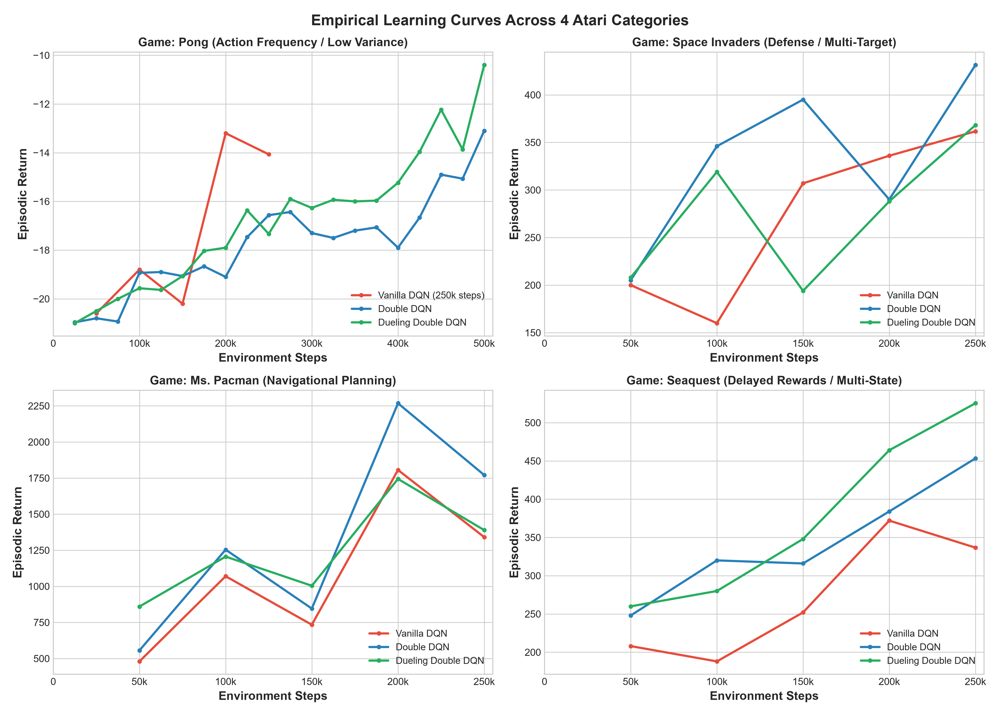
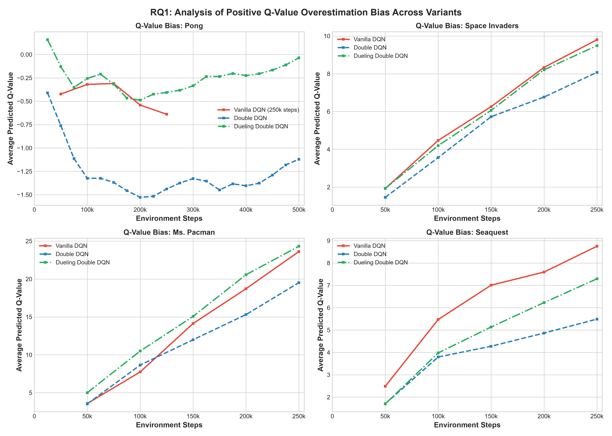
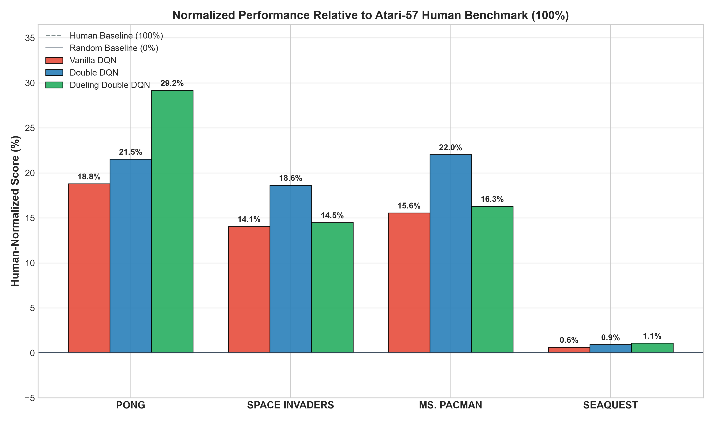

# Empirical Evaluation of DQN Variants on Atari 2600

Comparative evaluation of **Vanilla DQN**, **Double DQN**, and **Dueling Double DQN** across four Atari 2600 game categories.

* **Course**: TEK-3601 Machine Vision
* **Institution**: UiT The Arctic University of Norway
* **Candidate Number**: 35
* **Author**: Rehan Abu Hashir
* **Repository**: [GitHub Repository](https://github.com/Rehank54123/Empirical-Evaluation-of-DQN-Variants-Q-Value-Overestimation-and-Action-Value-Decomposition-on-Atari-.git)

---

## Overview & Research Questions

Standard Deep Q-Networks (DQN) suffer from two well-known limitations in visual reinforcement learning:
1. **Maximization Bias (Overestimation)**: Using $\max_{a'} Q(s', a')$ for the Bellman target systematically overestimates action-values in noisy or high-variance settings.
2. **Action-Value Coupling**: Standard architectures estimate $Q(s, a)$ directly for every action, even when the choice of action has little effect on the state's overall value.

This project investigates two specific research questions across four different Atari environments:

* **RQ1 (Value Overestimation)**: *Does Double Q-learning eliminate positive Q-value overestimation bias compared to Vanilla DQN across reactive vs. strategic games?*
* **RQ2 (Action-Value Decomposition)**: *Does the Dueling architecture improve sample efficiency when multiple discrete actions yield identical environmental states?*

---

## Atari Environments (4 Categories)

Following project feedback to evaluate across diverse operational dynamics, four games were selected representing distinct gameplay categories:

| Game | Category | Actions | Key Dynamics | Why Selected |
| :--- | :--- | :---: | :--- | :--- |
| **Pong** (`ALE/Pong-v5`) | Ball & Paddle (Reactive) | 6 (eff. 3) | Deterministic $\pm 1$ feedback | Low-dimensional control baseline to verify stable convergence. |
| **Space Invaders** (`ALE/SpaceInvaders-v5`) | Fixed-Screen Shooter | 6 | Delayed risk, high-variance targets | Direct test of **RQ1**: High reward variance often triggers severe overestimation in Vanilla DQN. |
| **Ms. Pacman** (`ALE/MsPacman-v5`) | Maze Navigation | 9 | Spatial foraging, corridor movement | Direct test of **RQ2**: In straight corridors away from ghosts, state value $V(s)$ dominates over action choice. |
| **Seaquest** (`ALE/Seaquest-v5`) | Resource Management | 18 | Delayed survival (oxygen timer), multi-objective | Large action space and delayed penalty (drowning) test representation stability. |

---

## Empirical Results

All models were evaluated using 30 independent test episodes under an $\epsilon = 0.01$ (near-greedy) policy. Raw scores are normalized against standard Atari-57 human and random baselines:

$$\text{HNS} = \frac{\text{Score}_{\text{agent}} - \text{Score}_{\text{random}}}{\text{Score}_{\text{human}} - \text{Score}_{\text{random}}}$$

### Benchmark Summary (30 Test Episodes)

| Game | Variant | Steps | Mean Score | Median | HNS (%) | Mean Pred. Q |
| :--- | :--- | :---: | :---: | :---: | :---: | :---: |
| **Pong** | Vanilla DQN | 250k | -14.07 ± 0.57 | -14.0 | 18.8% | -0.65 |
| | Double DQN | 500k | -13.10 ± 0.56 | -14.0 | 21.5% | -1.07 |
| | **Dueling Double DQN** | 500k | **-10.40 ± 0.56** | **-10.0** | **29.2%** | **0.10** |
| **Space Invaders** | Vanilla DQN | 250k | 361.67 ± 22.81 | 340.0 | 14.1% | 8.50 |
| | **Double DQN** | 250k | **431.33 ± 34.05** | **407.5** | **18.6%** | **6.72** |
| | Dueling Double DQN | 250k | 368.17 ± 32.78 | 360.0 | 14.5% | 7.97 |
| **Ms. Pacman** | Vanilla DQN | 250k | 1341.00 ± 82.69 | 1315.0 | 15.6% | 20.60 |
| | **Double DQN** | 250k | **1771.00 ± 110.46** | **1605.0** | **22.0%** | **14.47** |
| | Dueling Double DQN | 250k | 1389.67 ± 62.00 | 1405.0 | 16.3% | 20.95 |
| **Seaquest** | Vanilla DQN | 250k | 336.67 ± 24.80 | 320.0 | 0.6% | 8.80 |
| | Double DQN | 250k | 453.33 ± 25.32 | 450.0 | 0.9% | 5.45 |
| | **Dueling Double DQN** | 250k | **525.33 ± 30.37** | **520.0** | **1.1%** | **6.22** |

---

## Experimental Figures

### 1. Learning Curves
Episodic evaluation returns recorded at periodic evaluation checkpoints throughout training:



### 2. Q-Value Overestimation Tracking (RQ1)
Tracking of predicted Q-values across training steps showing that Double Q-learning consistently damps overoptimistic value estimates:



### 3. Human-Normalized Score Comparison
Benchmark performance normalized relative to random play (0%) and human play (100%):



---

## Repository Structure

```text
├── Presentation.pdf              # Project presentation slides
├── Presentation.pptx             # Editable presentation deck
├── requirements.txt              # Python dependencies
├── run_all.py                    # Master script to execute all experiments
├── atari_games.ipynb             # Starter interactive exploration notebook
├── atari_games_experiments.ipynb # Complete experiment notebook
├── configs/
│   └── default_config.py         # Hyperparameters and environment definitions
├── figures/                      # Generated evaluation and learning curve plots
│   ├── learning_curves.png
│   ├── q_overestimation_curves.png
│   └── hns_comparison.png
└── src/
    ├── __init__.py
    ├── agent.py                  # DQNAgent class (Vanilla, Double, Dueling)
    ├── evaluate.py               # 30-episode evaluation script
    ├── models.py                 # Nature CNN and Dueling network architectures
    ├── normalization.py          # Atari-57 human/random baseline baselines for HNS
    ├── replay_buffer.py          # Circular experience replay buffer (uint8)
    ├── train.py                  # Training loop with Q-bias tracking
    ├── visualize.py              # Plotting script for academic figures
    └── wrappers.py               # DeepMind standard Atari preprocessing wrappers
```

---

## Setup & Execution

### 1. Installation

```bash
# Clone the repository
git clone https://github.com/Rehank54123/Empirical-Evaluation-of-DQN-Variants-Q-Value-Overestimation-and-Action-Value-Decomposition-on-Atari-.git
cd Empirical-Evaluation-of-DQN-Variants-Q-Value-Overestimation-and-Action-Value-Decomposition-on-Atari-

# Create virtual environment (Python 3.10 - 3.12 recommended)
python -m venv .venv
# Activate:
# Linux/macOS: source .venv/bin/activate
# Windows: .venv\Scripts\activate

# Install dependencies
pip install -r requirements.txt
```

### 2. Running Experiments

Train all 12 runs (4 games × 3 algorithms):
```bash
python run_all.py
```

Train a single configuration:
```bash
# Example: Double DQN on Space Invaders
python -m src.train --algo double_dqn --game spaceinvaders --timesteps 250000 --seed 1
```

Evaluate a checkpoint:
```bash
python -m src.evaluate --checkpoint runs/double_dqn_spaceinvaders_seed1/final_model.pt --env_id ALE/SpaceInvaders-v5 --episodes 30
```

Regenerate all figures:
```bash
python -m src.visualize
```

---

## References

1. V. Mnih et al., "Human-level control through deep reinforcement learning," *Nature*, vol. 518, no. 7540, pp. 529–533, 2015.
2. H. van Hasselt, A. Guez, and D. Silver, "Deep reinforcement learning with double Q-learning," in *Proc. AAAI Conf. Artif. Intell.*, 2016, pp. 2094–2100.
3. Z. Wang et al., "Dueling network architectures for deep reinforcement learning," in *Proc. Int. Conf. Mach. Learn. (ICML)*, 2016, pp. 1995–2003.
4. M. G. Bellemare et al., "The Arcade Learning Environment: An evaluation platform for general agents," *J. Artif. Intell. Res.*, vol. 47, pp. 253–279, 2013.
5. M. C. Machado et al., "Revisiting the Arcade Learning Environment: Evaluation protocols and open problems for general agents," *J. Artif. Intell. Res.*, vol. 61, pp. 523–562, 2018.
